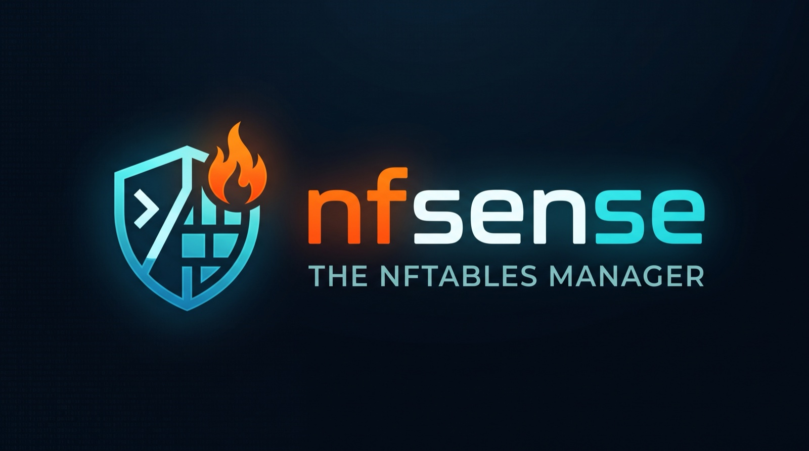

# nfsense — nftables firewall manager for Debian

<a id="top"></a>

[](#early-development-disclaimer)
[](./LICENSE)
[](https://go.dev/dl/)
[](https://www.debian.org/)
[](https://netfilter.org/projects/nftables/)

**Repo:** [github.com/hrodrig/nfsense](https://github.com/hrodrig/nfsense) · **Comparison:** [docs/compare.md](docs/compare.md) · **License:** [MIT](./LICENSE)

<a id="early-development-disclaimer"></a>

> ## ⚠ Early development — pre-alpha. Do not use in production.
>
> **There is no release, no installer, and no supported version.** The repository
> now builds and runs, but the only thing it can do is keep a draft document in
> SQLite. That is deliberate: the store comes before anything that talks to the
> kernel.
>
> **There is no nftables code in this repository.** The binary cannot read, check
> or change your firewall. No line of it has ever run against a real Debian host.
>
> **No warranty. No liability.** This software is provided **"AS IS"**, without
> warranty of any kind, express or implied, including but not limited to the
> warranties of merchantability, fitness for a particular purpose, and
> non-infringement. In no event shall the authors or contributors be liable for any
> claim, damages, or other liability — including but not limited to loss of data,
> loss of connectivity, loss of remote access, or business interruption — arising
> from, out of, or in connection with the software or its use.
>
> **You are solely responsible for every change made to your firewall.** A firewall
> change can lock you out of the machine you are configuring. Never evaluate this
> project on a host you cannot reach through a console.
>
> Use of this repository means you accept these terms. If you do not, do not use it.



**The problem:** pfSense is strong on FreeBSD + pf, but its PHP web control plane earned lasting distrust — opaque breakage after upgrades, `php-fpm` and SSH dying together on a "patched" box. One bad web-tier change takes the network and the recovery path down with it. On Linux there is no widely loved nftables manager with that clarity either: Shorewall stayed on iptables.

**How nfsense approaches it:** a single-host Debian CLI (TUI later) where the **intended** configuration lives in SQLite and reaches the kernel only through an explicit pipeline — **draft → check → apply → confirm → rollback**. No privileged web UI, no PHP, no `nft flush ruleset` over someone else's tables. The nftables work is confined to tables nfsense owns, and a timed confirm plus soft rollback is meant to give you back the box when a change goes wrong.

**Design influences** (ideas, not code): **Shorewall** for zone thinking and the "what I meant vs what got loaded" split; **VyOS** for commit/confirm culture; **pfSense** for top-level menu UX; **Clipper/Pascal TUIs** for the operator surface.

**Read before getting excited:** [docs/compare.md](docs/compare.md) compares this project against `firewall4`, `foomuuri`, `csf-firewall` and `iptables-apply`, and says plainly where nfsense is weaker — starting with the fact that **zones are not in v1** and that the compile-and-apply pipeline is table stakes, not a differentiator.

<a id="related-tools"></a>

**Related tools (same maintainer):**

| Project | What it does |
|---------|--------------|
| **[kzero](https://github.com/hrodrig/kzero)** | Bastion-first declarative Kubernetes workload reset (`down` / `up` / `reset` from YAML) |
| **[groot](https://github.com/hrodrig/groot)** | Kubernetes diagnostics archive CLI — `collect` → `.tar.gz`, validated and inspectable |
| **[kwd](https://github.com/hrodrig/kwd)** | Kubernetes workload watch dog — one-shot checks and a daemon with hysteresis |
| **[kpm](https://github.com/hrodrig/kpm)** | Kubernetes pod metrics → local SQLite, with rightsizing recommendations |
| **[pgwd](https://github.com/hrodrig/pgwd)** | PostgreSQL connection watchdog with Slack / Teams alerting |
| **[gghstats](https://github.com/hrodrig/gghstats)** | GitHub repository traffic beyond the built-in 14-day window |

## Table of contents

- [Early development disclaimer](#early-development-disclaimer)
- [Related tools](#related-tools)
- [What works today](#what-works-today)
- [Features](#features)
- [Requirements](#requirements)
- [Install](#install)
- [Planned UX](#planned-ux)
- [Status and roadmap](#status-and-roadmap)
- [Security note](#security-note)
- [Development](#development)
- [License](#license)

---

## What works today

Exactly one slice, end to end, against a real SQLite file:

```console
$ nfsense --data-dir .data draft show
{"format":"nfsense.draft","format_version":1,"body":{}}       # stdout
revision=0                                                    # stderr

$ printf '%s' '{"format":"nfsense.draft","format_version":1,"body":{"note":"hola"}}' \
    | nfsense --data-dir .data draft set --if-revision 0 --file -
revision=1

$ nfsense --data-dir .data draft show
{"format":"nfsense.draft","format_version":1,"body":{"note":"hola"}}
revision=1

# a stale write is refused, not silently merged
$ printf '%s' '{"format":"nfsense.draft","format_version":1,"body":{}}' \
    | nfsense --data-dir .data draft set --if-revision 0 --file -
nfsense: save draft: draft revision conflict                  # exit 3
```

What that proves, and what it does not:

- The draft is durable — a second process reads what the first one wrote, byte for byte, including keys the binary does not understand.
- Writes are compare-and-swap on a revision. Two operators cannot silently clobber each other.
- The envelope is validated before SQL: wrong `format`, non-integer `format_version`, trailing data and oversized documents are rejected with a message naming the field.
- The database file is created `0600` in a `0700` directory.
- **Nothing here touches nftables.** There is no `nft` call, no netlink, no `os/exec` in production code, enforced by a module-wide test.

[↑ Back to top](#top)

## Features

The draft store is real; everything else is the v1 scope as written in the roadmap, listed so the shape of the product is legible.

| Capability | State |
|---|---|
| Intended state in SQLite, revisioned, compare-and-swap | **working** |
| Envelope validation and durable draft across process restarts | **working** |
| Compile to nftables text and `nft --check` dry run | planned |
| Atomic apply into `table inet nfsense` only | planned |
| Confirm with a timer; automatic soft rollback | planned |
| Apply history: who, when, result, rendered artifact | schema only |
| Objects: hosts, networks, ports, groups → nftables sets/maps | planned |
| Filter policy: input/forward/output, policies, logging, conntrack | planned |
| WAN/LAN, VLANs, VIPs, router-only, NAT/SNAT/DNAT | planned |
| Local application users (who may change policy) | planned |
| Operator TUI over the same mutation model | planned |

[↑ Back to top](#top)

## Requirements

| Item | Value |
|------|-------|
| Target OS | Debian 13 (`trixie`) — no other distribution is tested in v1 |
| Firewall engine | `nftables` (the `nft` package). No iptables compatibility path |
| Privileges | `root` / `CAP_NET_ADMIN` to apply. Reading a draft does not need privilege |
| Build toolchain | Go **1.26+** (Debian 13 stable ships 1.24 — install from `trixie-backports` or go.dev) |
| Dev machine | macOS (Apple Silicon) builds and tests the current code; `nft` itself cannot run there |

[↑ Back to top](#top)

## Install

**No release exists.** No package, no Homebrew formula, no container image.

You can build the current source, which gives you `draft show` and `draft set` and nothing else:

```console
$ git clone https://github.com/hrodrig/nfsense
$ cd nfsense
$ go build -o nfsense ./cmd/nfsense
$ ./nfsense --data-dir .data draft show
```

Anything offering an nfsense download that is not this repository is not from this project.

[↑ Back to top](#top)

## Planned UX

This is a mock-up of the intended interface — **not** working output. It is here to show where the project is heading.

```console
# Inspect what is intended (reads SQLite, never touches the kernel)
$ nfsense draft show
revision 7 · format nfsense.draft v1 · 3 zones · 41 rules · 12 objects

# Validate and preview the diff before anything is loaded
$ nfsense check
nft --check: OK · 41 rules compile · 0 warnings

$ nfsense diff
+ table inet nfsense
+   chain input  { policy drop; ... }
-   chain input  { policy accept; ... }

# Apply atomically into owned tables, then confirm within the window
$ sudo nfsense apply
applied revision 7 · confirm within 120s or rollback is automatic

$ nfsense confirm
applied revision 7 confirmed · rollback disarmed
```

Every command above the `draft show` line is a design target. `check`, `diff`, `apply` and `confirm` do not exist yet.

[↑ Back to top](#top)

## Status and roadmap

Seven phases. The first is in progress: one of its five plans has landed.

| Phase | Capability | State |
|-------|------------|-------|
| 1 | Go skeleton + SQLite intended store (no nftables) | **in progress** — 1 of 5 plans |
| 2 | Owned nftables backend: compile, `nft --check`, diff, atomic apply | not started |
| 3 | Apply confirm, timed rollback, boot restore, apply history | not started |
| 4 | Objects and filter policy | not started |
| 5 | Interfaces, VLANs, VIPs, routing, NAT | not started |
| 6 | Full CLI, local auth, intended-vs-live visibility | not started |
| 7 | Operator TUI | not started |

Zones, a multi-host controller, an API/MCP plane, and any `pf` backend are explicitly **not** in v1. The scope argument, including which existing tool covers each gap better, is in [docs/compare.md](docs/compare.md).

[↑ Back to top](#top)

## Security note

- **A firewall change can remove your own access.** A special effort goes toward making the management path recoverable — a timed confirm, a soft rollback, and a boot-time restore — but none of it is a substitute for console access to the host.
- **Applying requires root.** Reading drafts does not. The data directory and database are owner-restricted (`0700` / `0600`) from the first commit, because a world-readable firewall policy is an information leak.
- **`nftables` only, owned tables only.** nfsense does not flush the ruleset and does not manage tables it did not create. Other tools' rules are not its business.
- **No web UI in v1.** This is a deliberate blast-radius decision, not an unfinished feature.
- **Nothing is security-audited.** No version of this project has been reviewed for security. Treat it as untrusted code.

**Reporting:** there is no `SECURITY.md` and no private advisory channel yet. Contact the maintainer through [github.com/hrodrig](https://github.com/hrodrig) rather than opening a public issue.

[↑ Back to top](#top)

## Development

```text
cmd/nfsense/          entry point; flags and exit codes live here
internal/cli/         cobra command tree, thin adapters over the service layer
internal/service/     domain operations; every mutation takes an Actor
internal/store/       SQLite: embedded goose migrations, CAS draft read/write
internal/draftdoc/    the JSON envelope: parse and validate, no database
docs/                 comparison and assets
```

| Command | What it does |
|---------|--------------|
| `go build ./cmd/nfsense` | build the binary |
| `go test ./... -count=1` | unit and integration tests |
| `go test ./... -race` | the same, with the race detector |
| `go vet ./...` | vet |

Local development on macOS requires `--data-dir` (or `NFSENSE_DATA_DIR`) pointing at a writable path, since the canonical default `/var/lib/nfsense` is Linux-only by design. Anything touching `nft` must run on a Debian host or in a Debian container with `CAP_NET_ADMIN`.

The planning record (roadmap, per-phase research, decisions, validation matrix) is kept privately and is not part of this repository.

[↑ Back to top](#top)

## License

MIT — see [LICENSE](./LICENSE).

[↑ Back to top](#top)
